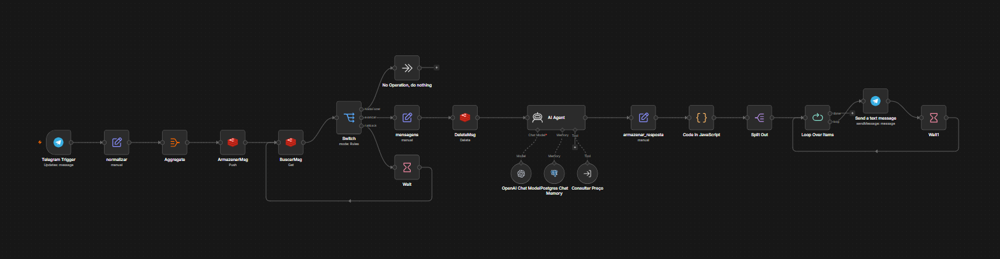

# Agente de Gráfica (n8n)

Bot de orçamento para gráfica, feito no n8n. O cliente conversa pelo Telegram, um agente de IA coleta o que falta (produto, papel, tamanho, quantidade, impressão) e consulta uma tabela de preços para montar o orçamento.

Montei para uma gráfica. A estrutura base (buffer de mensagens no Redis, resposta dividida em partes, memória no Postgres) vem do que aprendi em curso de n8n, e adaptei para o caso de orçamento.

## Como funciona

**Workflow principal** (`workflows/agente-de-grafica.json`)

1. **Telegram Trigger** recebe a mensagem.
2. **normalizar** extrai chat, nome, texto e data.
3. **Redis** guarda as mensagens do cliente numa lista. Se chegam várias seguidas, o fluxo espera 20 segundos e junta tudo antes de responder.
4. **AI Agent** (OpenAI `gpt-5-mini`) recebe a frase completa. Tem memória no Postgres (últimas 10 mensagens, uma sessão por chat e por dia).
5. A resposta é dividida em frases e enviada uma a uma. Orçamento nunca é dividido: o código detecta e manda inteiro.

**Ferramenta "Consultar Preço"** (`workflows/consultar-preco.json`)

Sub-workflow que o agente chama como tool. Baixa uma planilha `.xlsx` do Google Drive, filtra pelo que o cliente já informou e devolve um status:
`escolher_produto`, `varios_resultados`, `encontrado`, `formato_nao_encontrado`, `quantidade_nao_encontrada` ou `nao_encontrado`. Quando o resultado é ambíguo, devolve as opções que faltam em vez de preço.

Regras do prompt que valem destacar:
- Sempre consultar a ferramenta antes de falar qualquer preço, nunca reaproveitar um preço antigo da conversa.
- Informar só o valor final, nunca custo.
- Falar a língua do cliente ("só frente", "frente e verso") e não o jargão de gráfica (4x0, 4x4).

## Tecnologias

n8n, Telegram Bot API, OpenAI, Redis, PostgreSQL, Google Drive.

## Como rodar

1. Importe os dois arquivos de `workflows/` no n8n.
2. Crie as credenciais: Telegram, OpenAI, Redis, Postgres e Google Drive. Elas não vão no repositório.
3. Em `consultar-preco.json`, troque `COLOQUE_AQUI_O_ID_DA_PLANILHA` pelo ID do seu arquivo.
4. Em `agente-de-grafica.json`, no nó **Consultar Preço**, troque `COLOQUE_AQUI_O_ID_DO_WORKFLOW_CONSULTAR_PRECO` pelo ID do sub-workflow importado.
5. Ative o workflow principal.

## Planilha esperada

Não está no repositório. O código lê estas colunas (cabeçalho sem acento ou com, tanto faz):

`CODIGO`, `SERVICO`, `MODELO`, `FORMATO` (em mm, ex.: `148 x 210`), `MATERIAL`, `GRAMATURA`, `ENOBRECIMENTO`, `IMPRESSAO` (`4x0`, `4x4`, `4x1`, `1x0`, `1x1`), `ACABAMENTO`, `QTDE`, `VALOR FINAL`, `EXTRAS_DISPONIVEIS`.

## Observações

- Os preços e códigos de exemplo no prompt são fictícios.
- Esta versão pública lê o preço direto da coluna `VALOR FINAL`. A regra de cálculo de preço do negócio original foi removida.
- Credenciais, IDs de instância e links de arquivos foram retirados dos JSON.
